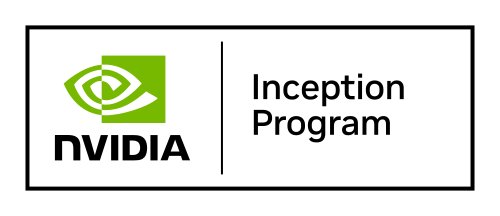

# FCL BOTS

Ligue française de combats de robots humanoïdes.

<a href="https://www.nvidia.com/en-us/startups/">
   

- Site : https://fclbots.com
- Devenir pilote : https://fclbots.com/devenir-pilote-robot
- Contact : contact@fclbots.com

Projet technique : [fcl-t800-sim](https://github.com/fclbots/fcl-t800-sim), simulation de combat pour le robot humanoïde T800.
